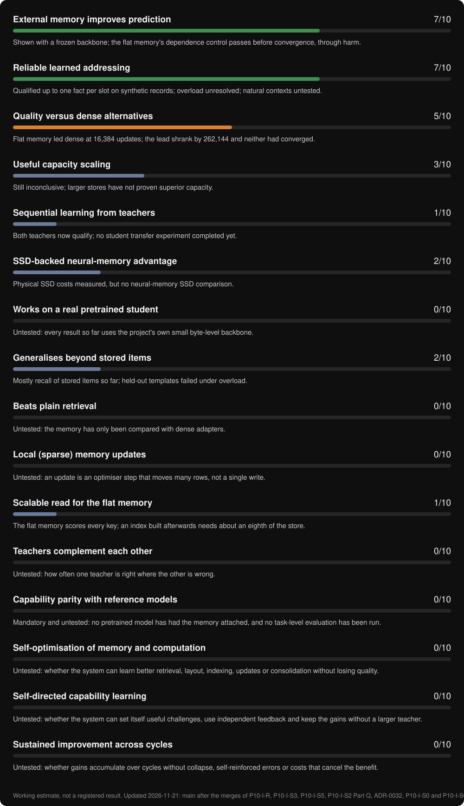

# ArborLM

**ArborLM** is a research proposal for a language model with **trainable hierarchical neural parameter memory**. The motivating hypothesis is that a model might learn to navigate a very large parameter-memory store while retrieving only a small, useful and physically local working set per token, potentially reducing data movement in SSD-backed inference.

> **Scientific status: memory helped frozen backbones, but P5 did not establish a hierarchy advantage.** Learned routing failed its improvement criterion; both trees reduced scored-key work but were slower than flat memory on the registered CPU workload. Earlier failures stand, the broader storage-scaling concept remains unproven, and scaling is not authorized. The human research lead authorized a Codex reviewer exception; Astra review was not performed.

- [E0 CPU baseline](results/e0-2026-11-12/) passed its training, evaluation and checkpoint reproducibility checks.
- [18-run RAM screen](results/p1-2026-11-12/) found a mean learned-tree improvement of 0.0092854773 nats/byte over the small dense baseline, below the registered 0.01 required for promotion.
- [12 frozen-checkpoint evaluations](results/memory-diagnostic-2026-11-12/) found mean validation loss increases of +0.002003993 nats/byte with memory disabled and +0.002146978 with values shuffled. Effects went in opposite directions across seeds, and both means were below the registered +0.005 threshold.
- [36-run controlled follow-up](results/p2-2026-11-12/) found mean loss increases of +0.000693748 nats/byte with memory disabled and +0.000685635 with values shuffled. Both effects were positive in 22 of 27 learned runs; neither reached +0.005 in any run. All three registered descriptive flags were false. Most of the mean gain over controls trained without memory (0.006731979 nats/byte) persisted after disabling memory (0.006038231). Training outcomes varied, but the follow-up did not establish a strong retained memory benefit at this budget. The earlier promotion failure stands.
- [36 longer-training continuations](results/p3-lt-2026-11-12/) improved validation loss for every learned run and control. Memory-dependence effects grew, but their mean changes and endpoint means remained below the registered 0.005 nats/byte thresholds. The endpoint quality guard passed; the two dependence flags failed.
- [63-cell frozen-backbone comparison](results/p4-2026-11-12/) passed the registered capacity and slot-association criteria: mean loss fell by 0.021989 nats/byte versus the unchanged backbone and rose by 0.022222 when values were shuffled. The equal-parameter dense adapter had lower loss in all 27 matched pairs, so dense tolerance and the composite P4 criterion failed. P1–P3 outcomes are unchanged.
- [117-cell hierarchy ablation and 36 timing workers](results/p5-2026-11-13/) found useful flat, fixed-tree and learned-tree memory. Learned routing's mean improvement over fixed was −0.000583 nats/byte, positive in only 10/27 pairs and 3/9 parent means, so its registered improvement gate failed. Both trees passed quality tolerance against flat and reduced key-plus-router score work to 12.89% of flat, but their addition latency was about 2.60× flat and full-forward latency about 2.19×. Both latency gates, all dense-reference criteria and the full learned-hierarchy criterion failed. Independent audits and root reruns passed; all P1–P4 outcomes remain unchanged.
- [P6 inference-only studies](docs/reviews/p6-results-2026-11-13/) on the frozen P5 checkpoints: an optimized tree retrieval selects exactly the same slots as the original on every checkpoint, but its registered timing criteria are **inconclusive** (unstable measurements on a loaded machine), and at small batches it was slower than flat. Top-2 routing recalls 0.79–0.91 of the exhaustive selection under the tree's own rule, yet exhaustive search does not improve prediction with these weights; all four routing-fidelity flags failed. No efficiency, capacity or storage claim follows. Reviewed under a human-requested Claude workflow; Astra review was not performed.
- [P7-A storage-page locality simulation](docs/reviews/p7a-results-2026-11-13/) on the frozen P5 checkpoints: under a page model with two rows per page and a small cache, the trees read 34–48% fewer cached value pages than a frequency-packed flat memory, but a null that preserves only each checkpoint's slot counts reproduces the whole gap. The registered outcome is **concentration-only**: the trees read fewer pages because they use fewer rows, not because of hierarchical placement. At the true row size the question is degenerate, and no NVMe experiment on these checkpoints is proposed. A simulation of page counts, not a storage measurement.
- [P7-B co-access layout simulation](docs/reviews/p7b-results-2026-11-13/) on the same checkpoints, on the existing evaluation stream and a fresh one: a flat memory whose slots are arranged by observed co-access gets locality **within 10%** of the existing hierarchy's on both streams (ratio 0.99–1.03 in the primary setting), and gains more from clustering than the trees gain from their branches. The hierarchy-specific locality hypothesis failed and the registered recommendation is not to scale the existing hierarchy on storage-locality grounds. Hypothetical row sizes; a simulation of page misses, not a storage measurement.
- [P8 locality-aware training pilot](docs/reviews/p8-results-2026-11-14/) (ADR-0015): ten cases, 60 cells, two fresh panels. **Incomplete (55 of 60 cells simulated) and negative:** no case met the locality criteria. Every locality term cut the slots in use by 46–92%; simulated misses fell because the working set shrank, not because of structure beyond slot popularity. Simulation at hypothetical row sizes, not a storage measurement.
- [P9-I query-interface prerequisite](results/p9i-run-attempt2-2026-11-15/OUTCOME.md) (ADR-0017 Part I): 57 cells, registered outcome **NO_INTERFACE_SELECTED**, accepted by the human lead as a registered negative result. Within 8,192 updates on this backbone no tested interface reached INTERFACE_WORKS at all three sizes (the arm that trains the block-0 attention was partial at 4,096 slots only, and degraded language modelling); oracle rungs show the memory stores and returns answers. Address collapse and draw sensitivity are exploratory diagnostics, not registered findings.

## Progress toward the target architecture

<!-- scorecard:start (generated by docs/scorecard/render_scorecard.py; do not edit) -->



The scores are the research lead's working estimate of how close each requirement of the target architecture is to being met. They are a planning aid: they are not registered results and not success claims. The evidence column quotes registered labels. Scale: 0 = nothing shown; 10 = shown at the scale the target architecture needs, replicated and accepted. Updated 2026-11-21 (main after the merges of P10-I-R, P10-I-S3, P10-I-S5, P10-I-S2 Part Q, ADR-0032, P10-I-S0 and P10-I-S6). Source: [`docs/scorecard/scorecard.toml`](docs/scorecard/scorecard.toml).

| Requirement | Score | Registered evidence | What would move it |
|---|---|---|---|
| External memory improves prediction | 7/10 | P4: registered capacity and slot-association criteria passed on a frozen backbone ([results](results/p4-2026-11-12/)).<br>P10-I-S3 line 1: DEPENDENT on fresh data, read on the tree memory, not converged; the control passes largely because wrong values hurt ([outcome](results/p10i-s3-run-2026-11-18/OUTCOME.md)).<br>P10-I-S6: D[FLAT] DEPENDENT at 262,144 updates, not converged and not dependence-qualified; it passes through harm (wrong values hurt), and reading the mean value row loses the gain ([outcome](results/p10i-s6-run-2026-11-20/OUTCOME.md)). | The flat memory's dependence at convergence is still unread: P10-I-S6 did not reach convergence. No study for it exists yet. |
| Reliable learned addressing | 7/10 | P10-S0: ADDRESSING-QUALIFIED (4,096 AND 16,384); OVERLOAD NOT QUALIFIED; 65,536 slots a probe only ([outcome](results/p10s0-run-2026-11-16/OUTCOME.md)).<br>P10-I-S0: OVERLOAD UNRESOLVED AT load 2 (CONVERGENCE NOT SHOWN); ADDRESSING QUALIFIED UP TO 1 fact per slot; licence loads 0.5 and 1.0 only; independently recomputed ([outcome](results/p10is0-run-2026-11-18/OUTCOME.md)). | Above one fact per slot nothing is licensed: 8K facts in 4K slots held in 2 of 10 cells, with convergence not shown after a budget refusal. Natural contexts: no study yet. |
| Quality versus dense alternatives | 5/10 | P10-I-S3 line 2 [FLAT]: MEMORY AHEAD (DENSE STILL IMPROVING), mean lead +0.0127 against 0.005, 27 of 27 cells ([outcome](results/p10i-s3-run-2026-11-18/OUTCOME.md)).<br>P10-I-S6: CONVERGENCE NOT REACHED (BOTH STILL IMPROVING) at 262,144 updates; descriptive only: LEAD SHRINKING, mean lead +0.0124 at 16,384 updates and +0.0068 at 262,144; independently recomputed; accepted as registered ([outcome](results/p10i-s6-run-2026-11-20/OUTCOME.md), [acceptance](results/p10i-s6-run-2026-11-20/ACCEPTANCE.md)).<br>P10-I-S3 line 2 [TREE]: INCONCLUSIVE (MEMORY RATE AT EDGE). P10-I-R: the tree is behind the flat memory and no read-time cause is identified ([outcome](results/p10ir-run-2026-11-18/OUTCOME.md)). | The ordering at convergence is unknown: sixteen times the duration was not enough, and at the last rung both arms improve per doubling by more than the lead. No further study exists yet. The tree needs a training study that does not exist. |
| Useful capacity scaling | 3/10 | P10-S1: CAPACITY-INCONCLUSIVE; SATURATION-INCONCLUSIVE; the 16,384 to 65,536 step NOT TESTED ([results](results/p10s1-run-2026-11-17/)). | P10-I-S1 (capacity): calibrated, not yet frozen; blocked on a quiet-machine limit this machine does not reach. |
| Sequential learning from teachers | 1/10 | P10-S2: TRANSFER-INCONCLUSIVE: TEACHERS-NOT-QUALIFIED; the transfer question was not tested ([ADR-0022](docs/decisions/ADR-0022-p10-s2-two-teacher-transfer.md)).<br>P10-I-S2 Part Q: TEACHERS-QUALIFIED (DISJOINT DRAWS) on the third registered attempt, independently recomputed; a qualification of teachers and training material, not a transfer result ([outcome](results/p10is2-partq-run-20261119-attempt3/OUTCOME.md)). | P10-I-S2 Part T (the transfer itself): implemented, never audited or run; its implementation audit is under way, then rehearsals and a registered run. |
| SSD-backed neural-memory advantage | 2/10 | P10-I-S5 (engineering only): BYTES CONFIRMED EXACTLY; CONTIGUOUS REQUEST CHEAPER PER PAGE; scientific part NOT EVALUABLE (PREREQUISITES NOT MET) ([outcome](results/p10is5-run-2026-11-18/OUTCOME.md)). | P10-II-S5: page traces and drive reads of trained stores (drafted, not approved). A scientific claim still needs learned addressing at a size where storage matters. |
| Works on a real pretrained student | 0/10 | No study yet. The frozen backbones of P4 to P10-I are trained in this repository on byte-level text ([research handoff](docs/RESEARCH_HANDOFF.md)). | Attach the flat memory to a small pretrained model, train on text it has not seen, compare with an adapter of equal size. |
| Generalises beyond stored items | 2/10 | P10-S0: qualified at 4,096 and 16,384 slots including held-out templates, but the overload failures are on held-out templates alone ([outcome](results/p10s0-run-2026-11-16/OUTCOME.md)).<br>P10-I-R: every label carries RECALL OF TRAINED RANDOM FACTS and DICT DOMINATES ON THIS TASK ([outcome](results/p10ir-run-2026-11-18/OUTCOME.md)). | Score only on held-out items and paraphrases, with a plain dictionary as a baseline. P10-I-S0 (running) reads held-out templates under overload. |
| Beats plain retrieval | 0/10 | No comparison with a non-learned retrieval store exists. P10-I-R notes that a dictionary dominates on its task ([outcome](results/p10ir-run-2026-11-18/OUTCOME.md)). | Add a retrieval baseline (stored items fetched by similarity, no training) to the quality comparison. |
| Local (sparse) memory updates | 0/10 | No registered measurement of what one update changes. P10-I-S5 excluded writes ([outcome](results/p10is5-run-2026-11-18/OUTCOME.md)). | Measure rows changed per update (P10-II-S5, Part U, drafted); then test a write rule that touches only the addressed rows. |
| Scalable read for the flat memory | 1/10 | P10-I-R: INDEX APPROACHES FLAT ONLY ABOVE 512; about N/8 candidates needed at 32K facts / 16K slots; for the tree, EXACT SEARCH HARMS ([outcome](results/p10ir-run-2026-11-18/OUTCOME.md)). | A training study: an index or a tree trained with the memory (wider or soft routing, re-indexing). None exists or is authorised. |
| Teachers complement each other | 0/10 | No measurement. P10-S2 ended TRANSFER-INCONCLUSIVE: TEACHERS-NOT-QUALIFIED ([ADR-0022](docs/decisions/ADR-0022-p10-s2-two-teacher-transfer.md)). | Run both frozen teachers on one benchmark and record each score, the either-right ceiling and the both-right floor, before any transfer. |
| Capability parity with reference models | 0/10 | No study yet. Every result above uses one measure, predictive loss, on a 27,392-parameter byte-level backbone; it does not establish parity with any pretrained model ([draft ADR-0032](docs/decisions/ADR-0032-model-level-requirement-capability-parity.md), not approved). | Measure the reference models themselves on independent evaluations (proposed test M0, not approved), then the first contact of the memory with a real student. |
| Self-optimisation of memory and computation | 0/10 | No study yet. Proposed direction, not a result ([draft ADR-0032](docs/decisions/ADR-0032-model-level-requirement-capability-parity.md)). | A staged, preregistered test against an outside search given the same compute; to be proposed for approval. |
| Self-directed capability learning | 0/10 | No study yet, and no system capable enough to test it exists. Proposed direction, not a result ([draft ADR-0032](docs/decisions/ADR-0032-model-level-requirement-capability-parity.md)). | Needs a real student that has first acquired a capability from a teacher; then a bounded, preregistered single cycle. |
| Sustained improvement across cycles | 0/10 | No study yet. Proposed direction, not a result ([draft ADR-0032](docs/decisions/ADR-0032-model-level-requirement-capability-parity.md)). | Needs a single self-directed cycle shown first; then a fixed number of bounded cycles scored on evaluations the process cannot see. |

<!-- scorecard:end -->

## Begin here

- **[Canonical research context](docs/RESEARCH_HANDOFF.md)** — origin story, precise problem, proposed first architecture, hypotheses, prior art, phases, migration and publication rules.
- [Agent policy](AGENTS.md) — mandatory Astra research-orchestration/validation vs lower-tier coding model split.
- [Experiment protocol](docs/EXPERIMENT_PROTOCOL.md) — baselines, metrics, scientific controls, reproducibility requirements.
- [Research log](docs/RESEARCH_LOG.md) — chronology, decisions and negative outcomes.
- [Paper outline](docs/PAPER_OUTLINE.md) — publication-ready structure without invented results.
- [Codex kickoff prompt](prompts/CODEX_KICKOFF.md) — first implementation task.

## Scope

The completed model experiments ran locally on CPU with model weights in RAM. The project will not deploy to the owner's infrastructure. NVMe, distillation and scaling remain outside the current scope.

## Code license

Apache-2.0 (see `LICENSE`). Datasets, pretrained weights and future paper artifacts require separate rights review.

## Repository

https://github.com/Dandush03/ArborLM

## E0 CPU baseline

[E0's approved specification](docs/decisions/ADR-0003-e0-approved-spec.md) tests a
small dense Transformer's training, evaluation and checkpoint infrastructure on
generated integer motifs. This is an engineering check; it supplies no evidence
about hierarchy, storage I/O or language ability. The specification was reviewed
under the research lead's Codex override. Astra review was not performed.

Use a Git checkout on macOS arm64 or Linux x86-64. Install the pinned Python and
dependencies, then run the checks from the repository root:

```sh
uv python install
uv sync --locked --extra pilot
uv run --extra pilot ruff check .
uv run --extra pilot mypy src/arborlm
uv run --extra pilot pytest
uv run python -m arborlm smoke --config configs/e0_cpu_smoke.toml --output-root experiments
```

The smoke command creates two independent training runs, reloads the first final
checkpoint in a new process, and compares a separate interrupted/resumed run.
It checks bitwise equality within one numerical environment. macOS and Linux are
separate numerical environments; no cross-platform bitwise match is promised.

Run individual operations with the same configuration:

```sh
uv run python -m arborlm train --config configs/e0_cpu_smoke.toml --output-root experiments
uv run python -m arborlm eval --checkpoint experiments/<run-id>/checkpoint-32 --output-root experiments
uv run python -m arborlm train --config configs/e0_cpu_smoke.toml --output-root experiments --stop-after 16
uv run python -m arborlm train --config configs/e0_cpu_smoke.toml --output-root experiments --resume experiments/<stopped-run-id>/checkpoint-16
```

Substitute actual run IDs. Load only trusted local checkpoints generated by
ArborLM; checksums detect corruption, not a maliciously altered checkpoint and
index. Atomic publication requires a local filesystem supporting an exclusive
directory rename.

Each command prints a unique run directory, with a terminal status, captured
stdout/stderr, source snapshot and lock hash, resolved config, dataset
checksums and raw events. Smoke stores its five child runs under `children/`.
Training runs also retain immutable checkpoints. Retries write a fresh run
directory; preserve failure records and local artifacts for review. CI artifact
uploads are temporary and do not replace the local research archive.


## Registered RAM pilot (local only)

[The P1_SCREEN protocol](docs/decisions/ADR-0005-ram-pilot-spec.md) defines the
fixed six-variant, three-seed screen. After reviewer preflight, run against the
approved local train and validation acquisition:

```sh
uv sync --locked --extra pilot
uv run --locked --extra pilot python -m arborlm pilot \
  --config configs/p1_ram_screen.toml --data-dir data/wikitext2 --output-root experiments
```

The suite rechecks the pinned files, freezes one ranked byte-token dataset,
and records all cells under a unique local run directory. The suite stops on a
failed cell and retains partial evidence and the unexecuted cell list. Keep
dataset bytes and binary checkpoints local. CI only exercises synthetic
fixtures and E0; it does not acquire WikiText-2 or execute this pilot.

## Controlled optimization follow-up (local only)

[ADR-0007](docs/decisions/ADR-0007-controlled-optimization-followup.md) defines the
27 learned runs and nine controls, all at the same model size and training
budget. To reproduce the run with the approved local data, use a fresh results
directory; the command refuses to overwrite an existing export.

```sh
uv sync --locked --extra pilot
uv run --locked --extra pilot python -m arborlm.optimization_followup \
  --data-dir data/wikitext2 --output-root experiments \
  --results-root results/p2-reproduction
```

Keep corpus bytes and binary checkpoints local. Astra review was not performed;
human merge and publication approval remain pending.
