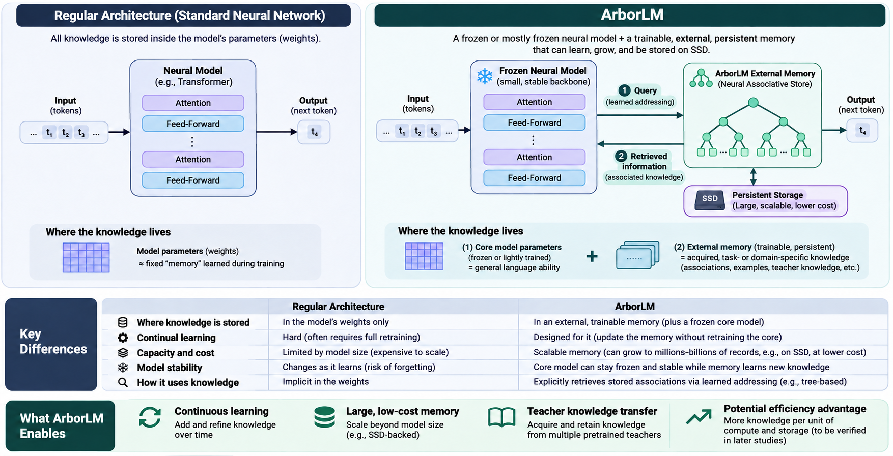

# ArborLM — concept diagram

**This diagram shows the target concept, not results.** ArborLM is unproven research. None of the benefits listed in the diagram is established, and the row "What ArborLM Enables" should be read as "what ArborLM aims to enable".

## What the records say today (2026-11-17)

| In the diagram | Status in the research records |
|---|---|
| Learned addressing as the query path | Qualified only at 4,096 and 16,384 slots, with caveats, and not under overload (P10-S0, ADR-0020). P10-S1 supplies addresses by an oracle. |
| Tree-based memory | P5 found the tree slower than flat memory. The P10 studies use flat memory. |
| Millions to billions of records on SSD at lower cost | Not tested. The memories trained so far have tens of thousands of slots and run in RAM. No measured SSD result exists. |
| Teacher knowledge transfer | P10-S2 ended TRANSFER-INCONCLUSIVE: TEACHERS-NOT-QUALIFIED (ADR-0022). |
| Continuous learning | Not demonstrated. |
| Efficiency advantage | Not demonstrated. At equal trainable parameters a dense adapter beat the memory in every P4 comparison. |

What has been shown: in P4, the memory improved on the frozen baseline in 27 of 27 comparisons, and shuffling its values harmed prediction in 27 of 27.

The registered outcomes are in `docs/decisions/` and `results/`; this page does not replace them. `Astra review: NOT_PERFORMED`.
